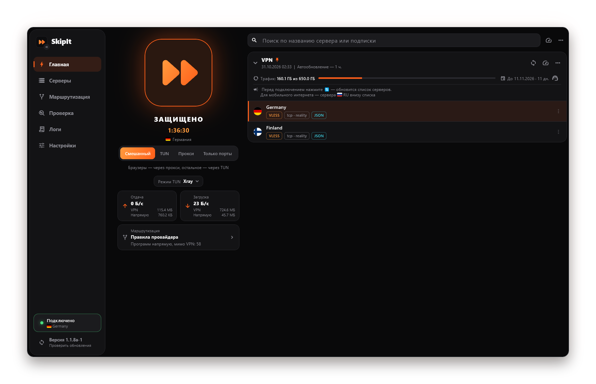
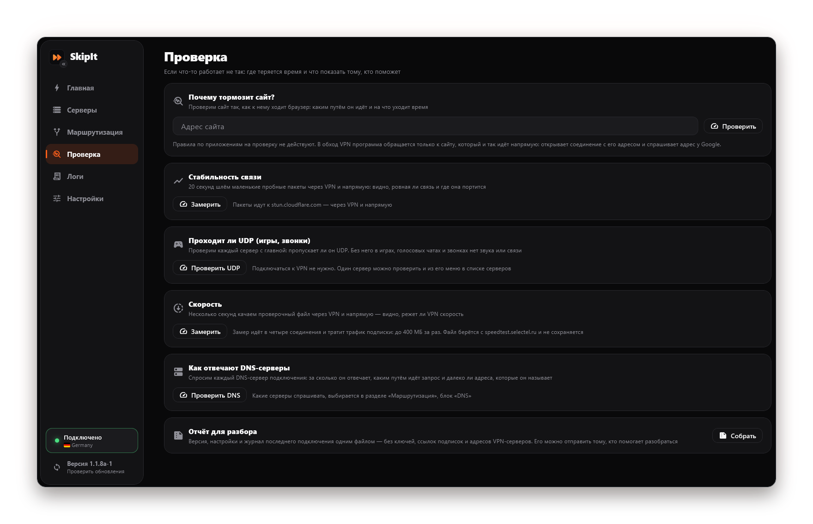
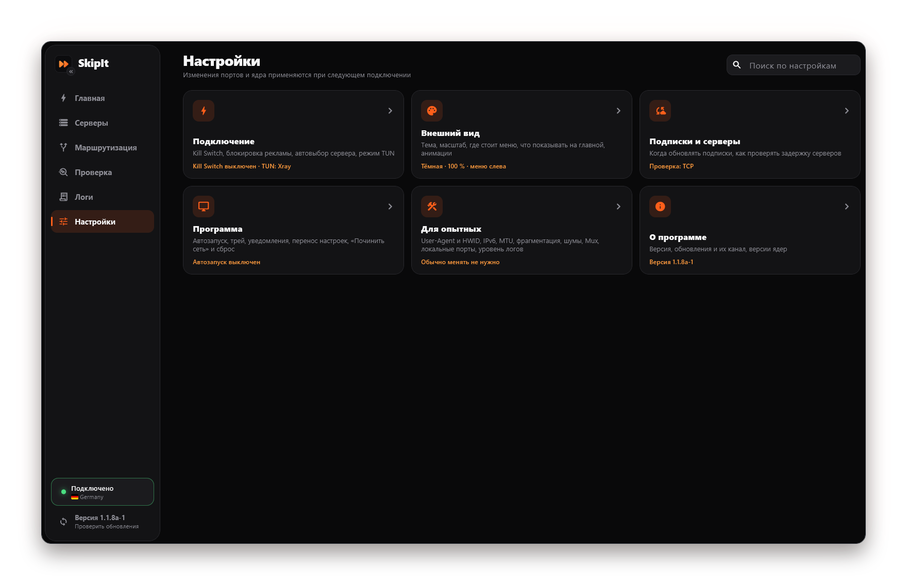

<picture>
  <source media="(prefers-color-scheme: dark)"  srcset="docs/logo-dark.png">
  <source media="(prefers-color-scheme: light)" srcset="docs/logo-light.png">
  
</picture>

  🚀 <b>Быстрый и простой VPN-клиент для Windows</b> 🛡️

 

 

[Возможности](#-о-проекте) · [Скриншоты](#-как-это-выглядит) · [Установка](#-установка) · [Режимы](#-режимы-подключения) · [Маршрутизация](#-маршрутизация) · [Протоколы](#-протоколы) · [Вопросы](#-частые-вопросы)

 

---

> [!WARNING]
> **ОТКАЗ ОТ ОТВЕТСТВЕННОСТИ / DISCLAIMER**  
> Программа предоставляется по принципу «как есть» (AS IS). SkipIt — это клиент: он подключается к серверам, которые вы получаете у своего VPN-провайдера, и не предоставляет собственных серверов. Авторы не несут ответственности за использование программы в целях, противоречащих законодательству.

> [!IMPORTANT]
> Поддерживаются **Windows 10 и 11 (64-бит)**. Для режимов **«Смешанный»** и **TUN** нужны права администратора — по умолчанию SkipIt запрашивает их при запуске (это можно выключить в настройках).

---

## 💡 О проекте

**SkipIt** — клиент для подключения к VPN по подписке. Вставили ссылку от провайдера — и всё работает: серверы, флаги стран, трафик, срок подписки и правила, какие сайты идут мимо VPN.

<table>
<tr>
<td width="33%" valign="top">

📋 <b>Ctrl+V — и готово</b> 
Ссылка от провайдера вставляется прямо в окно — серверы уже в списке

</td>
<td width="33%" valign="top">

🧠 <b>Правила провайдера</b> 
Что идёт напрямую, а что через VPN, решается само — без ручной настройки

</td>
<td width="33%" valign="top">

🎮 <b>Программы на выбор</b> 
Через VPN только нужные программы — или все, кроме списка

</td>
</tr>
<tr>
<td width="33%" valign="top">

🛡️ <b>Kill Switch</b> 
VPN оборвался — интернет закрыт, а не идёт напрямую с вашего адреса

</td>
<td width="33%" valign="top">

🔐 <b>Порты под паролем</b> 
Чужая программа на компьютере не пройдёт через ваш VPN

</td>
<td width="33%" valign="top">

🧯 <b>Не ломает интернет</b> 
Найдёт мешающий VPN, а при выходе вернёт всё как было

</td>
</tr>
<tr>
<td width="33%" valign="top">

🔎 <b>«Почему тормозит сайт?»</b> 
Покажет, каким путём идёт сайт и на что уходит время

</td>
<td width="33%" valign="top">

🧾 <b>Понятный журнал</b> 
Что куда идёт: через VPN, напрямую или блокируется

</td>
<td width="33%" valign="top">

🔔 <b>Живёт в трее</b> 
Сервер, режим и Kill Switch — прямо из меню значка

</td>
</tr>
</table>

<b>Все возможности подробно</b>

#### 🚀 Быстрый старт

* 📋 **Ctrl+V — и готово** — ссылка на подписку или сервер вставляется прямо в окно: на главной или в разделе «Серверы».
* 🔳 **QR-коды** — сервер или подписку можно добавить по QR-коду с экрана, из картинки или скриншота в буфере обмена и показать кодом, чтобы перенести на телефон.
* 🌐 **Русский и английский** — язык интерфейса выбирается по Windows, сменить его можно в настройках.
* 🔄 **Обновляется сам** — новая версия ставится одной кнопкой, без поиска установщика.

#### 🌍 Серверы и подписки

* 🌍 **Серверы с флагами и задержкой** — видно, где сервер и насколько он быстрый; подписки можно закреплять вверху списка и менять местами перетаскиванием.
* 🗂️ **Раздел «Серверы»** — лишние подписки и отдельные серверы можно скрыть с главной, а серверы выстроить по задержке или по названию.
* 🧠 **Правила провайдера применяются сами** — какие сайты идут напрямую, а какие через VPN, решает конфиг провайдера. Ничего не нужно настраивать руками, а свои правила можно добавить к ним.
* 🎮 **Игры и программы — на ваш выбор** — можно пустить через VPN только нужные программы или, наоборот, исключить их.

#### 🛡️ Безопасность

* 🛡️ **Kill Switch** — если VPN оборвался, интернет закрывается, а не идёт напрямую с вашего настоящего адреса. Включается в настройках.
* 🔐 **Локальные порты под паролем** — другая программа на компьютере не сможет ходить через VPN без вашего ведома: логин и пароль у каждой установки свои.
* 🧯 **Не ломает интернет** — перед подключением SkipIt проверяет, не работает ли другой VPN, и предлагает закрыть его; при выходе возвращает системные настройки как были.

#### 🔎 Диагностика

* 🔎 **Раздел «Проверка»** — «Почему тормозит сайт?»: впишите адрес, и программа покажет, каким путём сайт идёт (через VPN или напрямую) и на что уходит время: на поиск адреса, на дорогу или на сам сайт. Можно вписать несколько сайтов через запятую. Там же — стабильность связи (потери и всплески через VPN и мимо него), замер скорости, проверка DNS-серверов и отчёт для разбора одним файлом; результат любой проверки копируется одной кнопкой.
* 🌐 **Свой DNS и его проверка** — можно задать свои DNS-серверы с запасными и одной кнопкой увидеть, за сколько отвечает каждый, каким путём идёт запрос и далеко ли адреса, которые он называет.
* 🧾 **Понятный журнал** — записи разбиты по подключениям и дням, под сообщениями ядер — пояснения простыми словами. В «Соединениях» видно, что куда идёт: через VPN, напрямую или блокируется.

#### ⚙️ Удобство

* 🔔 **Живёт в трее** — закрыли окно, а VPN продолжает работать. Из меню значка можно подключиться, сменить сервер, режим подключения и режим TUN, включить Kill Switch. Если VPN оборвётся, пока окно спрятано, над треем появится уведомление — его можно смахнуть.
* ⚙️ **Два ядра для TUN на выбор** — виртуальный адаптер может поднимать sing-box или само ядро Xray.
* 🔎 **Поиск по настройкам** — нужная настройка находится по названию или по слову вроде «порт», «трей», «автозапуск».

> [!NOTE]
> **Есть идеи или нашли баг?** Создавайте [Issue](https://github.com/getskipit/skipit/issues). Об уязвимостях сообщайте приватно — как, написано в [SECURITY.md](SECURITY.md).

---

## 📸 Как это выглядит

<table>
<tr>
<td width="50%" valign="top" align="center">
 
<b>Проверка</b> 
Почему тормозит сайт, стабильность связи, UDP для игр и звонков, скорость, DNS и отчёт для разбора
</td>
<td width="50%" valign="top" align="center">
 
<b>Настройки</b> 
Разбиты на группы, нужная находится поиском по названию или по слову
</td>
</tr>
</table>

---

## 📥 Установка

1. Откройте [последний релиз](https://github.com/getskipit/skipit/releases/latest).
2. Скачайте **`SkipIt-Setup-Windows-<версия>.exe`** и запустите его.
3. Скопируйте ссылку на подписку от вашего VPN-провайдера и нажмите **Ctrl+V** на главной странице SkipIt.
4. Нажмите на большую кнопку ▶▶ — готово.

> [!NOTE]
> Установщик пока не подписан сертификатом, поэтому Windows может показать синее окно «Система Windows защитила ваш компьютер». Нажмите **«Подробнее» → «Выполнить в любом случае»**. Скачивайте SkipIt только со страницы релизов этого репозитория.

Всё нужное уже внутри установщика — **больше ничего скачивать не надо**:

| Что внутри | Зачем |
| :--- | :--- |
| **SkipIt** | Сама программа: окно, трей, подписки, настройки |
| **Xray-core** | Подключение к серверам по протоколам VLESS, VMess, Trojan и др.; по умолчанию — и режим TUN |
| **sing-box** | Второе ядро для режима TUN — на выбор: весь трафик компьютера и правила по программам |
| **Wintun** | Драйвер виртуального сетевого адаптера для режима TUN |

Версии ядер видны в **Настройки → О программе**. Они обновляются вместе с программой — отдельно их обновлять не нужно.

---

## 🔌 Режимы подключения

| Режим | Что идёт через VPN | Когда выбирать |
| :--- | :--- | :--- |
| **Смешанный** *(по умолчанию)* | Браузеры — через прокси (Windows получает его файлом автонастройки), остальные программы — через TUN | Лучший вариант для большинства: всё работает, сайты определяются точнее. Программы, которые не понимают файл автонастройки (например, игры на Python), прокси не видят и идут через TUN по правилам приложений |
| **TUN** | Весь трафик компьютера | Игры и программы, которые не умеют работать через прокси |
| **Прокси** | Только программы, использующие системный прокси (браузеры) | Когда нельзя дать права администратора или не включается сетевой адаптер VPN |
| **Только порты** | Ничего в системе не меняется — локальные SOCKS и HTTP (с логином и паролем) | Для ручной настройки отдельных программ |

Режим переключается на главной и в меню значка в трее. Подключение, которое ещё идёт, можно отменить повторным нажатием на кнопку.

### Режим TUN

В режимах «Смешанный» и TUN под переключателем режимов есть кнопка **«Режим TUN»** (то же самое — в **Настройки → Подключение** и в меню значка в трее):

| Режим | Как работает |
| :--- | :--- |
| **Xray** *(по умолчанию)* | Всё делает ядро Xray: перехватывает трафик компьютера и решает, что отправить через VPN-сервер, а что напрямую — мимо него |
| **sing-box** | Трафик перехватывает ядро sing-box и передаёт его Xray, а тот решает, что отправить через VPN-сервер, а что напрямую |

Правила по программам, блокировка IPv6 и защита от утечки DNS работают в обоих режимах.

### Kill Switch

Включается в **Настройки → Подключение** или в меню значка в трее, по умолчанию выключен. Работает в режимах «Смешанный» и TUN, с любым ядром.

Пока он включён и VPN подключён, в интернет выходит только то, что идёт через VPN. Если VPN оборвался, программы остаются без интернета, а не идут в сеть напрямую, — пока SkipIt не подключится заново или вы сами не нажмёте **«Открыть интернет без VPN»** на главной. Локальная сеть (роутер, принтер, общие папки) при этом остаётся доступной. Сама SkipIt при проверке задержки соединяется с VPN-серверами напрямую — иначе задержку до них не измерить.

Обычное «Отключить» и выход из программы снимают блокировку: интернет не останется закрытым без SkipIt.

### Локальные порты и пароль

Пока VPN подключён, SkipIt держит на этом компьютере два порта: SOCKS (по умолчанию `10808`) и HTTP (`10809`). Через них в VPN можно направить отдельную программу, вписав в неё адрес `127.0.0.1` и номер порта.

Порты закрыты логином и паролем — без них другая программа через VPN не пройдёт. Логин и пароль случайные, у каждой установки свои; посмотреть, скопировать и сменить их можно в **Настройки → Для опытных → Локальные порты**. Там же пароль выключается.

| Порт | С паролем |
| :--- | :--- |
| **SOCKS** | Всегда |
| **HTTP** | Только в режиме «Только порты». В остальных режимах порт остаётся без пароля: в «Смешанном» и «Прокси» им пользуется системный прокси Windows, а он передать пароль не умеет; в «TUN» через него продолжают ходить программы, запомнившие системный прокси |

Из сети порты недоступны, пока вы сами не включите «Разрешить подключения из локальной сети».

---

## 🧭 Маршрутизация

| Что | Как работает |
| :--- | :--- |
| **Правила провайдера** | Если провайдер отдаёт полный конфиг (JSON), SkipIt использует его целиком: какие сайты напрямую, какие через VPN, что блокируется. Краткое содержание правил видно в разделе «Маршрутизация», а сам конфиг — через «Показать JSON» в меню сервера |
| **Свои профили** | Можно создать свои правила или взять шаблон («Россия напрямую», «Только заблокированное»). Профилями можно делиться ссылкой, понимаются и ссылки формата Happ. С правилами провайдера профиль работает вместе: его списки «через VPN», «напрямую» и «блокировать» решают за то, о чём у провайдера правила нет; если сайт есть и там, и там — действует правило провайдера |
| **DNS** | По умолчанию — DNS из конфига провайдера (у обычных серверов — из профиля). «Мой DNS» заменяет его своими серверами: удалённые — для сайтов через VPN, локальные — для сайтов напрямую; в каждом поле можно указать несколько адресов через запятую — следующий спрашивается, если предыдущий не ответил. Понимаются обычный DNS, DNS по TCP и DoH. Кнопка «Проверить DNS» открывает раздел «Проверка» и показывает по каждому серверу подключения время ответа, путь запроса — через VPN или напрямую — и за сколько мимо VPN отвечают адреса, которые он называет: сервер может отвечать быстро, но называть далёкие узлы сайтов |
| **Приложения** | Два режима: «все через VPN, кроме списка» или «только выбранные через VPN». Программу можно выбрать из запущенных, по файлу, папке или имени. Программы, которые обновляются сами (Discord, Slack и другие), добавляются целой папкой — правило не сбивается после их обновления. Работает в режимах «Смешанный» и TUN, с любым ядром; в «Смешанном» действует и на браузеры, которые ходят через системный прокси |

Какая маршрутизация действует сейчас, показано на главной под кнопкой подключения.

---

## 🧩 Протоколы

| Протокол | Варианты |
| :--- | :--- |
| **VLESS** | Reality, XTLS Vision, XHTTP, WebSocket, gRPC, HTTPUpgrade, mKCP |
| **VMess** | TLS, WebSocket, gRPC и др. |
| **Trojan** | TLS, WebSocket, gRPC |
| **Shadowsocks** | включая 2022 |
| **Hysteria2** | — |
| **SOCKS** | — |

Подписки понимаются в любом популярном формате: ссылки, base64, полный JSON-конфиг Xray. Для панелей Remnawave SkipIt сам запрашивает JSON с правилами провайдера.

> [!NOTE]
> Внутри — свежий Xray-core, и у него есть два ограничения, которые не зависят от SkipIt:
> * параметр `allowInsecure` («не проверять сертификат») удалён — серверы с самоподписанным сертификатом работают только с закреплённым отпечатком (`pcs`);
> * VLESS без шифрования (без TLS или Reality) к серверам в интернете запрещён.
>
> У серверов, которых это касается, в списке показывается значок предупреждения.

---

## 🔄 Обновления

SkipIt сам проверяет обновления при запуске. Если есть новая версия, внизу меню появится пометка **«Обновление»** — одна кнопка скачает установщик, сверит его контрольную сумму и запустит.

| Канал | Что приходит |
| :--- | :--- |
| **Стабильный** *(по умолчанию)* | Только стабильные версии |
| **Бета** | Ещё и тестовые версии — новые функции раньше, но возможны ошибки |

Канал меняется в **Настройки → О программе**.

---

## 📋 Системные требования

| Параметр | Требование |
| :--- | :--- |
| **ОС** | Windows 10 или 11, 64-бит |
| **Права** | Администратор — для режимов «Смешанный» и TUN |
| **Диск** | около 150 МБ |
| **Подписка** | Ссылка от любого VPN-провайдера (Remnawave, Marzban, 3x-ui и др.) |

---

## ❓ Частые вопросы

<b>Нужно ли что-то докачивать после установки?</b>

Нет. Всё уже внутри установщика.

<b>Нужны ли SkipIt права администратора?</b>

Нет. Режимам «Смешанный» и TUN нужен виртуальный сетевой адаптер — его поднимает служба SkipIt, которую ставит установщик. Сама программа работает с обычными правами, и при запуске Windows ничего не спрашивает. Если служба по какой-то причине не работает, SkipIt попросит права при запуске, как раньше.

<b>Где SkipIt хранит подписки?</b>

В папке `%APPDATA%\SkipIt` — её можно открыть из Настроек. При обновлении подписки сохраняются, а удаление программы стирает их вместе с папкой.
Они зашифрованы для вашей учётной записи Windows, поэтому на другой компьютер переносятся не копированием папки,
а через Настройки → Программа → «Экспорт» и «Импорт».

<b>VPN работает, а окна нет.</b>

SkipIt свёрнут в трей — нажмите на его значок рядом с часами. Полностью выйти можно через меню значка → «Выход».

<b>После обновления программа, в которую вписан адрес <code>127.0.0.1:10808</code> или <code>:10809</code>, перестала работать.</b>

С версии 1.1.0 SOCKS-порт закрыт логином и паролем всегда, а HTTP-порт — в режиме «Только порты». Впишите их в настройки прокси этой программы — они лежат в **Настройки → Для опытных → Локальные порты → «Логин портов» и «Пароль портов»**. Подробнее — в разделе «Локальные порты и пароль».

<b>Как убрать с главной лишние подписки и серверы?</b>

В меню подписки или сервера (три точки) выберите «Скрыть с главной». Скрытое пропадает с главной и из меню значка в трее, но остаётся в разделе «Серверы» — там же его можно вернуть. Скрытая подписка продолжает обновляться.

<b>Одновременно открыт другой VPN-клиент.</b>

Два VPN сразу мешают друг другу. Перед подключением SkipIt проверяет это сам и предлагает закрыть другой VPN.

<b>Ошибка «Windows не смогла включить сетевой адаптер VPN».</b>

Это сбой на стороне Windows — обычно после того, как другой VPN-клиент удалил сетевые адаптеры. Помогает перезагрузка компьютера. До неё можно подключиться в режиме «Прокси»: кнопка для этого есть прямо под сообщением.

<b>Не обновляется подписка или нет сети, хотя VPN включён.</b>

Если установлен файрвол (например, simplewall) или антивирус, разрешите в нём `SkipIt.exe`, `skipit-xray.exe` и `skipit-sing-box.exe` из папки программы.

<b>Программа стоит в списке «напрямую», а заблокированный сайт в ней всё равно открывается.</b>

«Напрямую» значит «мимо VPN-сервера». Адреса сайтов при этом узнаются через DNS из конфига провайдера, а некоторые провайдеры настраивают его так, что отдельные сервисы открываются и без VPN. Куда на самом деле пошло соединение, видно в **Логи → Соединения**.

<b>Сайт проверки IP показывает мой настоящий адрес, хотя VPN включён.</b>

Провайдеры часто пускают такие сайты (`2ip.ru`, `ipify.org` и подобные) напрямую — это правило из их конфига, его видно в разделе «Маршрутизация». Проверьте на другом сайте или посмотрите строку этого сайта в **Логи → Соединения**.

<b>Что будет, если VPN оборвётся?</b>

SkipIt сразу снимает подключение и один раз пробует подключиться заново. Пока идёт переподключение (несколько секунд), программы ходят в интернет напрямую. Чтобы этого не было, включите **Kill Switch** в **Настройки → Подключение**: тогда на время обрыва интернет закрывается.

---

## 🗑️ Удаление

**Параметры → Приложения → SkipIt → Удалить.** Перед удалением SkipIt сам корректно отключит VPN и вернёт настройки прокси — интернет не пропадёт. Вместе с программой удаляется и папка `%APPDATA%\SkipIt` — подписки, серверы, настройки и журналы, как будто SkipIt не было. Чтобы переустановить и сохранить подписки, перед удалением сделайте «Экспорт» (Настройки → Программа).

---

🛠 Разработчикам: сборка из исходников и выпуск версий — в [docs/DEVELOPMENT.md](docs/DEVELOPMENT.md)

🔐 Безопасность и данные — в [SECURITY.md](SECURITY.md)

📄 Лицензия [Apache-2.0](LICENSE) · название и логотип SkipIt лицензией не передаются ([NOTICE](NOTICE)) · сторонние компоненты — в [THIRD_PARTY_NOTICES.md](THIRD_PARTY_NOTICES.md)

